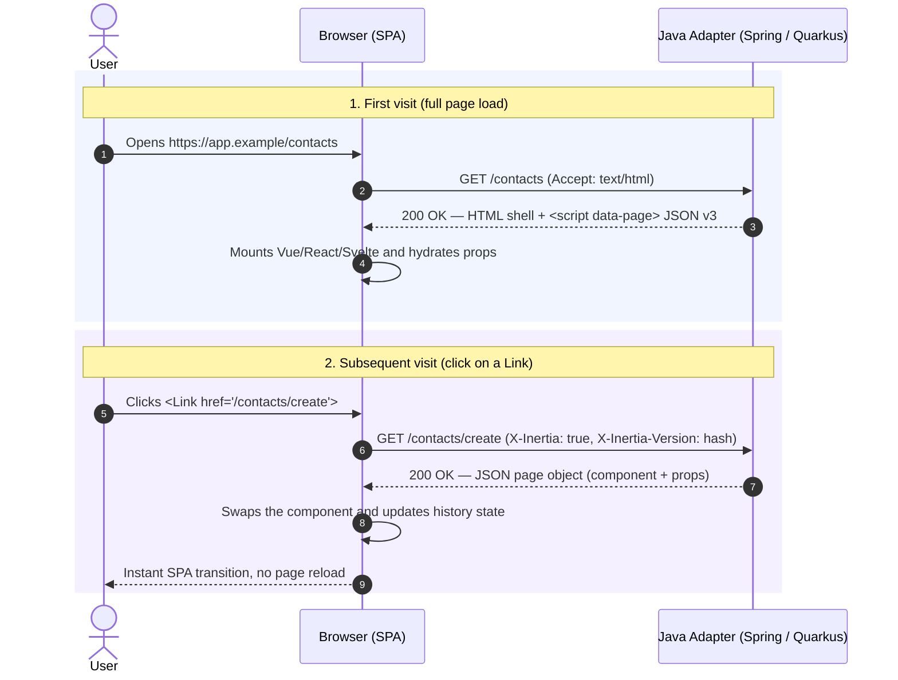

# How It Works

Inertia.js is a protocol, not a framework. The server decides which page
component and which props the client should render; the client knows how to
render it and how to visit the next page without a full reload.

This page explains the two request types every Inertia application has: the
initial HTML visit and the subsequent XHR visit.

## The lifecycle



## The initial visit

On the first request the adapter renders the **root template** with three
things:

1. The mount point: `<div id="app">`.
2. The page object as JSON: `<script type="application/json" data-page="app">`.
3. The JavaScript entry point produced by Vite.

The page object contains the component name, its props, the canonical URL, the
asset version and protocol metadata such as `deferredProps` or `liveProps`.
The client reads the script tag, resolves the component (for example
`Contacts/Index` → `src/pages/Contacts/Index.vue`) and mounts the application.

### v3-pure bootstrap

Version 3 keeps the payload in **one place only**. The `<div id="app">` element
must not carry a `data-page` attribute anymore:

```html
<body>
  <div id="app"></div>
  <script type="application/json" data-page="app">{"component":"Contacts/Index",...}</script>
  <script type="module" src="/assets/app.js"></script>
</body>
```

The legacy v1/v2 shape duplicated the payload in the `data-page` attribute and
is intentionally unsupported, with no opt-in. The v3-pure bootstrap is about
**59% smaller** in initial HTML bytes and keeps a single source of truth.

## The XHR visit

When a user clicks an Inertia `<Link>` (or calls `router.visit()`), the client:

1. Intercepts the click and prevents the browser navigation.
2. Sends the same URL as an XHR/fetch request with `X-Inertia: true` and the
   current `X-Inertia-Version`.
3. Receives a JSON page object instead of HTML.
4. Swaps the component, merges props and updates `window.history`.

If the asset version does not match, the server answers `409 Conflict` with the
`X-Inertia-Location` header; the client performs a full reload so the user gets
the new bundle exactly once.

## Protocol headers

| Header | Direction | Meaning |
|---|---|---|
| `X-Inertia` | both | Marks an Inertia visit and an Inertia JSON response |
| `X-Inertia-Version` | both | Asset version; mismatch → `409` + `X-Inertia-Location` |
| `X-Inertia-Partial-Component` | request | Component the client is currently rendering |
| `X-Inertia-Partial-Data` | request | `only`: comma-separated prop keys to refresh |
| `X-Inertia-Partial-Except` | request | `except`: comma-separated prop keys to skip |
| `X-Inertia-Reset` | request | Resets merge/prepend metadata for the listed keys |
| `X-Inertia-Except-Once-Props` | request | Once props the client already has |
| `X-Inertia-Error-Bag` | request | Targets a named validation error bag |
| `X-Inertia-Location` | response | Forces a full navigation to an external URL (`409`) |
| `Precognition` | request | Validate-only dry run (alias `X-Inertia-Precognition`) |
| `Precognition-Validate-Only` | request | Fields to validate (alias `X-Inertia-Precognition-Validate-Fields`) |

For the complete wire contract see [Protocol & TCK](/reference/protocol).

## Links and programmatic visits

`<Link>` is an anchor under the hood: middle-click, `Ctrl+click` and
"open in new tab" keep working and fall back to a normal full-page visit.
Programmatic navigation uses the router:

::: code-group

```js [Vue 3]
import { router } from '@inertiajs/vue3'

router.visit('/contacts/create')
router.get('/contacts', { search: 'alice' }, { preserveState: true })
router.reload({ only: ['contacts'] })
```

```js [React 19]
import { router } from '@inertiajs/react'

router.visit('/contacts/create')
router.get('/contacts', { search: 'alice' }, { preserveState: true })
router.reload({ only: ['contacts'] })
```

```js [Svelte 5]
import { router } from '@inertiajs/svelte'

router.visit('/contacts/create')
router.get('/contacts', { search: 'alice' }, { preserveState: true })
router.reload({ only: ['contacts'] })
```

:::

Plain `<a href="https://example.com">` links are not intercepted: they perform
a normal browser navigation. The same applies to responses that are not Inertia
pages (file downloads, streams, third-party redirects).

## History and scroll

Every Inertia visit updates the browser history with the page's URL and
component state. The server can instruct the client to encrypt or clear that
state, and each visit decides whether scroll position is preserved. This is
covered in [History](/guide/history) and
[Scroll Management](/guide/scroll-management).

## What the server does on every visit

Both adapters run the same pipeline:

1. Detect Inertia (`X-Inertia`), parse partial reload headers and version.
2. Run shared-data contributors and resolve the controller result.
3. Build the page object: props, metadata, URL, version flags.
4. Apply validation errors, flash messages and error bags if present.
5. Serialize once, safe-encoded for script context, and write the response.

The pipeline is shared through `inertia-core`; the Spring MVC, Quarkus REST and
Quarkus Reactive transports only differ in how the request and response are
bridged to the servlet or Vert.x APIs.

Next: [Starter Kits](/guide/starter-kits) · [Pages](/guide/pages) ·
[Props](/guide/props)
